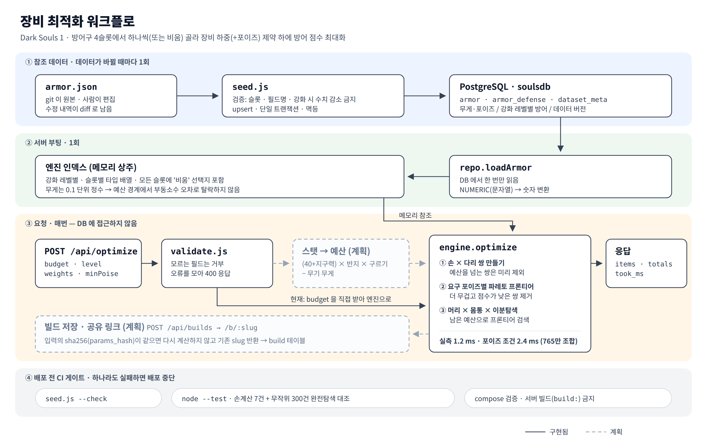

# souls — Dark Souls 1 방어구 최적화

장비 하중(과 포이즈) 제약 안에서 방어 점수가 가장 높은 방어구 조합을 찾는 API입니다.
[하이브리드 클라우드 인프라](../README.md) 위에 올라가는 두 번째 서비스입니다.



## 무엇을 푸는가

머리 · 몸통 · 손 · 다리 슬롯마다 방어구를 하나씩 고르거나 비워 두고,

- **제약**: Σ무게 ≤ 예산, (선택) Σ포이즈 ≥ 최소 포이즈
- **목표**: Σ(가중치 × 스탯) 최대화 — 물리·마법·화염·번개·출혈·독·저주·포이즈 중 원하는 가중치

을 만족하는 조합을 찾습니다. 슬롯마다 50~60개라 조합은 약 765만 개입니다.

## 현재 상태

| 기능 | 상태 |
|---|---|
| 참조 데이터 시딩 (`armor.json` → PostgreSQL) | ✅ |
| 최적화 엔진 (무게 / 무게 + 포이즈) | ✅ |
| `GET /api/armor`, `POST /api/optimize`, `GET /health` | ✅ |
| 지구력·반지·구르기 등급으로 예산 계산 | 🔲 계획 — 지금은 `budget`을 직접 받음 |
| 빌드 저장 · 공유 링크 (`POST /api/builds`, `/b/:slug`) | 🔲 계획 (스키마만 준비됨) |
| 컨테이너 배포 | 🔲 계획 |
| 전체 방어구 데이터 | 🔲 현재 Elite Knight 세트 4피스 |

## 알고리즘

완전탐색(765만 조합)을 하지 않고 **meet in the middle + 파레토 프론티어**로 줄입니다.

1. 손 × 다리 쌍을 미리 만들고 예산을 넘는 쌍은 버린다
2. 무게 오름차순으로 훑으면서, **더 무거운데 점수가 같거나 낮은 쌍을 제거**한다. 남은 것(프론티어)은 무게와 점수가 함께 증가한다
3. 머리 × 몸통 조합마다 남은 예산으로 프론티어를 **이분탐색**한다. 프론티어 성질상 "살 수 있는 가장 무거운 쌍"이 곧 "점수가 가장 높은 쌍"이다

버리는 쌍은 최적해가 될 수 없음이 보장되므로 **근사가 아니라 정확한 최적해**입니다.

포이즈 하한은 **포이즈가 정수라는 점**을 이용해 요구 포이즈별로 프론티어를 따로 만들어 처리합니다.
화염 방어처럼 연속값인 제약은 이 방식으로 흡수되지 않아서, v1은 제약을 무게 + 포이즈로 제한했습니다.

### 측정

실제 DS1 방어구 207개(빈 슬롯 포함 7,646,940 조합), Xeon 2.1 GHz 단일 스레드, Node 22.

| 질의 | 엔진 | 완전탐색 |
|---|---|---|
| 무게만 | **1.24 ms** | 수십 ms |
| 무게 + 포이즈 ≥ 53 | **2.37 ms** | 수십 ms |

4개 질의 모두 완전탐색과 최적값이 일치했습니다. 배포 대상 서버(1 vCPU)에서 이 수치가 어떻게 나오는지는 배포 후 다시 측정할 예정입니다.

### 구현에서 정한 것

- **빈 슬롯도 항상 선택지** — DS1에서는 어느 부위든 벗을 수 있습니다
- **무게는 0.1 단위 정수로 계산** — `4.5 + 11.7 + 3.7 + 6.9`가 부동소수로는 26.8과 정확히 같지 않을 수 있어, 예산에 딱 맞는 조합이 탈락하지 않게 합니다
- **점수가 같으면 더 가벼운 조합** — 같은 입력에 항상 같은 결과가 나옵니다
- **데이터에 없는 강화 레벨은 그 이하에서 가장 높은 레벨로 대체**하고, 응답에 실제 사용한 레벨을 표시합니다

## API

### `POST /api/optimize`

```json
{
  "budget": 26.7,
  "level": 10,
  "weights": { "physical": 1 },
  "minPoise": 30
}
```

| 필드 | 필수 | 설명 |
|---|---|---|
| `budget` | ✅ | 방어구에 쓸 수 있는 하중 (0 초과 500 이하) |
| `level` | | 강화 레벨 0~10, 기본 10 |
| `weights` | ✅ | `physical` `magic` `fire` `lightning` `bleed` `poison` `curse` `poise` 중 하나 이상, 0~100 |
| `minPoise` | | 최소 포이즈 (정수), 기본 0 |

모르는 필드가 있으면 조용히 무시하지 않고 **400**으로 거부합니다. 오타가 "결과가 왜 이상하지?"로 돌아오지 않게 하기 위해서입니다.

응답 (Elite Knight 세트, 실제 출력):

```json
{
  "feasible": true,
  "score": 186.4,
  "items": {
    "head":  { "id": 1, "name_en": "Elite Knight Helm",     "level": 10 },
    "chest": { "id": 2, "name_en": "Elite Knight Armor",    "level": 10 },
    "hands": null,
    "legs":  { "id": 4, "name_en": "Elite Knight Leggings", "level": 10 }
  },
  "totals": { "weight": 23.1, "poise": 30, "physical": 186.4, "...": "..." },
  "data_version": "ds1-2026-09-21",
  "took_ms": 0.98
}
```

예산이 0.1 모자라 하나를 벗어야 하는 상황입니다. 포이즈 제약이 없으면 물리 손실이 가장 작은 **투구**를 벗지만,
투구를 벗으면 포이즈가 28이 되어 30을 못 넘기므로 **장갑**을 벗는 답이 나옵니다.

조건을 만족하는 조합이 없으면 `{ "feasible": false }`를 돌려줍니다.

### `GET /api/armor?slot=head`

메모리에 올린 방어구 데이터를 돌려줍니다. 응답은 `{ data_version, count, armors }` 형태이고, `slot`을 빼면 전체를 돌려줍니다.

### `GET /health`

DB 연결과 로드된 방어구 수, 데이터 버전을 돌려줍니다.

## 구조

```
souls/
├── src/
│   ├── server.js      HTTP 서버 · 부팅 시 데이터 로드 · SIGTERM 정상 종료
│   ├── engine.js      최적화 엔진 (DB·HTTP를 모르는 순수 함수)
│   ├── validate.js    요청 검증
│   ├── repo.js        DB → 엔진 입력 변환 (repository)
│   └── db.js          커넥션 풀
├── test/engine.test.js
├── scripts/seed.js    참조 데이터 시딩
├── db/schema.sql
└── data/ds1/armor.json
```

**최적화 요청은 DB에 접근하지 않습니다.** 방어구 데이터는 부팅 때 한 번 읽어 메모리에 올리고,
DB는 참조 데이터 원본과 (앞으로) 사용자 빌드 저장에만 씁니다.

## 데이터

- **원본은 `data/ds1/armor.json`** 입니다. DB에 직접 넣지 않고, 이 파일을 고친 뒤 시딩합니다. 수정 내역이 git diff로 남고, 서버를 새로 만들어도 같은 데이터가 재현됩니다.
- 시딩은 **멱등**(몇 번 돌려도 같은 결과), **단일 트랜잭션**(중간에 실패하면 전부 되돌림)입니다.
- 시딩 전 검증: 슬롯 · 필드명 오타 · `+0` 누락 · 이름 중복 · **강화했는데 수치가 줄어드는 경우**.

### 출처와 한계

> ⚠️ 현재 수치는 **검증 전**입니다.

- 지금 들어 있는 값은 [cosmcbun/Dark-Souls-Armor-Optimizer](https://github.com/cosmcbun/Dark-Souls-Armor-Optimizer)의 CSV에서 가져왔습니다. 이 저장소에는 라이선스가 없어서 **원본이 아니라 대조용**으로만 쓰고, 최종 수치는 위키와 대조해 채울 예정입니다.
- 해당 CSV를 검증기로 돌려보면 강화했는데 수치가 줄어드는 항목이 **14건** 나옵니다. 그대로 가져오지 않는 이유입니다.
- 물리 방어는 아직 하나로 합쳐져 있습니다(`strike` / `slash` / `thrust`는 비어 있음).
- 공식 한글 명칭은 확인 전이라 비워 두었습니다(`name_ko`).

## 실행

테스트는 DB도 `npm install`도 필요 없습니다.

```bash
node --test          # 손계산 기댓값 7건 + 무작위 300건 완전탐색 대조 + 요청 검증
node scripts/seed.js --check    # 데이터 검증만
```

서버를 띄우려면 PostgreSQL과 환경변수가 필요합니다.

```bash
npm install
export DB_HOST=127.0.0.1 DB_USER=soulsuser DB_PASSWORD=... DB_NAME=soulsdb
npm run seed
npm start            # http://localhost:3000
```

```bash
curl -X POST localhost:3000/api/optimize \
  -H 'Content-Type: application/json' \
  -d '{"budget":26.7,"weights":{"physical":1},"minPoise":30}'
```

## 테스트를 믿을 수 있는가

테스트가 통과한다는 것만으로는 부족해서, **엔진에 버그를 일부러 심고 테스트가 실패하는지** 확인했습니다.

| 심은 버그 | 결과 |
|---|---|
| 이분탐색 경계 `<=` → `<` | 2건 실패로 검출 |
| 요구 포이즈 계산에서 몸통 포이즈 누락 | 2건 실패로 검출 |
| 빈 슬롯 선택지 제거 | 3건 실패로 검출 |

무작위 대조 테스트는 세 버그를 모두 잡습니다. 엔진이 돌려준 조합을 원본 데이터로 다시 계산해서 비교하기 때문에, 엔진 내부 값을 그대로 믿지 않습니다.

CI(`.github/workflows/ci.yml`)에서 데이터 검증과 이 테스트가 통과해야만 배포가 진행됩니다.